# EDA findings

## Price & Size

### Q1. What is the distribution of property prices?

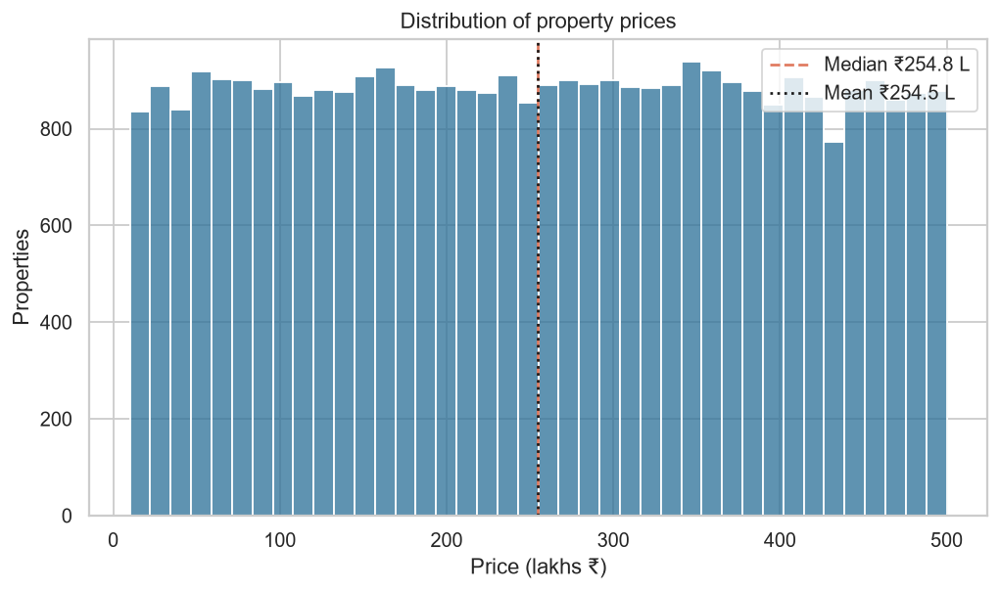

**Finding:** Prices range from ₹10.0 L to ₹500.0 L; median ₹254.8 L, mean ₹254.5 L, skewness +0.01. The shape is almost perfectly flat (uniform-like) (KS distance to a uniform distribution = 0.006). Real housing prices are usually strongly right-skewed, so this flat shape suggests the data is simulated rather than scraped from real listings.

|       |   Price_in_Lakhs |
|:------|-----------------:|
| count |         35359    |
| mean  |           254.48 |
| std   |           140.79 |
| min   |            10.02 |
| 25%   |           132.79 |
| 50%   |           254.83 |
| 75%   |           375.03 |
| max   |           500    |

### Q2. What is the distribution of property sizes?

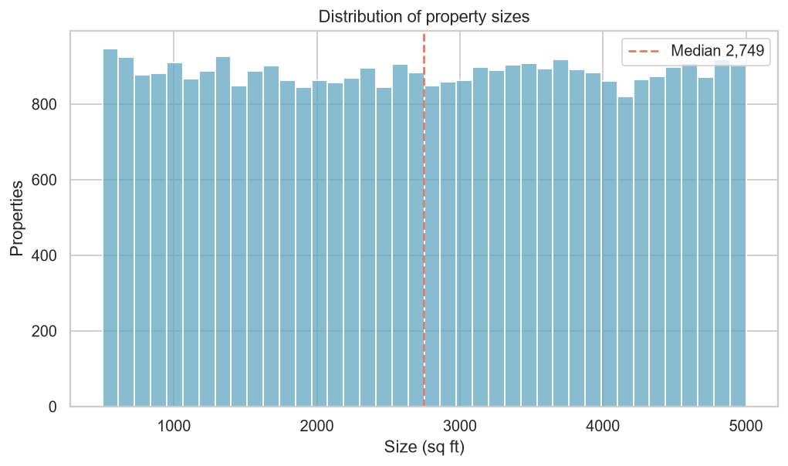

**Finding:** Sizes run from 500 to 5,000 sq ft (median 2,749). The distribution is almost flat / uniform (KS distance 0.005); each size band holds a similar share of listings.

|       |   Size_in_SqFt |
|:------|---------------:|
| count |        35359   |
| mean  |         2747   |
| std   |         1305.6 |
| min   |          500   |
| 25%   |         1610   |
| 50%   |         2749   |
| 75%   |         3869   |
| max   |         5000   |

### Q3. How does price per sq ft vary by property type?

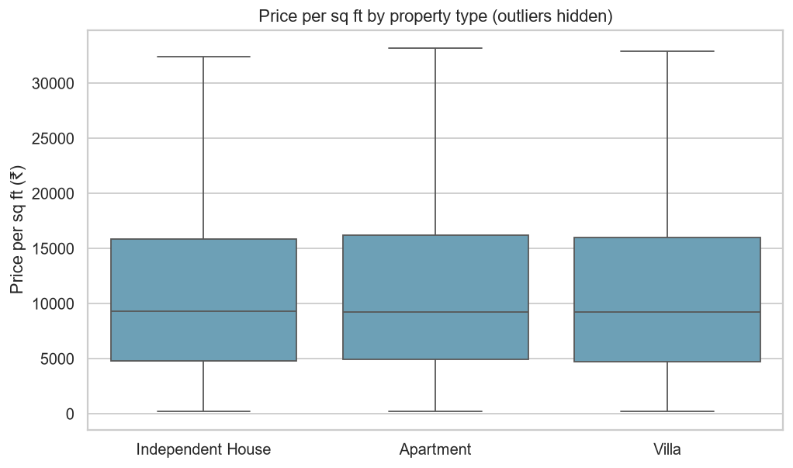

**Finding:** Mean price/sq ft: highest Apartment (₹13,281), lowest Independent House (₹13,009) - a 2.1% gap. ANOVA p=0.223, effect size η²=0.0001 -> no statistically significant difference.

| Property_Type     |   count |   mean |   median |
|:------------------|--------:|-------:|---------:|
| Apartment         |   11841 |  13281 |     9268 |
| Independent House |   11709 |  13009 |     9277 |
| Villa             |   11809 |  13043 |     9209 |

### Q4. Is there a relationship between property size and price?

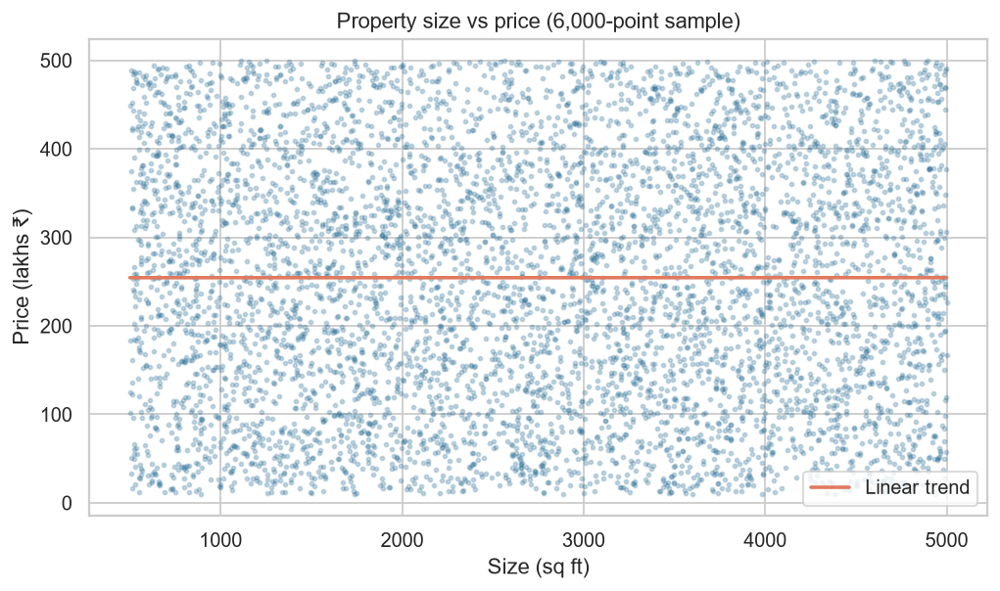

**Finding:** Pearson r between size and price = +0.000 (Spearman +0.000, p=0.977): not statistically significant. Variance in price explained by size: 0.00%. Average price of homes under 1,000 sq ft is ₹255.7 L vs ₹254.8 L for 4,000-5,000 sq ft (-0.4%). Price does not rise with size, which is unusual for real markets, so size cannot be used to predict price in this dataset.

| Size_in_SqFt   |   count |   mean |
|:---------------|--------:|-------:|
| <1k            |    4025 |  255.7 |
| 1-2k           |    7842 |  255.8 |
| 2-3k           |    7737 |  251.9 |
| 3-4k           |    7948 |  254.7 |
| 4-5k           |    7807 |  254.8 |

### Q5. Are there any outliers in price per sq ft or property size?

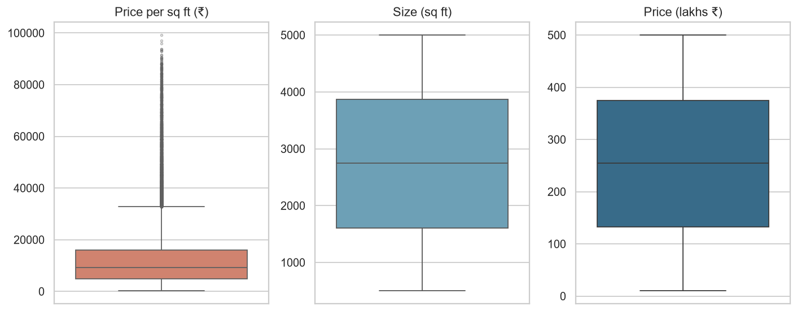

**Finding:** IQR rule: price/sq ft has 2,808 high outliers (7.94%), while size and price have none. Outlying rows are small homes: their median size is 792 sq ft vs 2,749 overall - price/sq ft explodes because the denominator is small. They are valid combinations, so they were flagged and kept (and winsorised at the 99th percentile for modelling).

|    | Column             |   Lower fence |   Upper fence |   # below |   # above |   % outliers |
|---:|:-------------------|--------------:|--------------:|----------:|----------:|-------------:|
|  0 | Price_per_SqFt_INR |      -11979.2 |       32814.7 |         0 |      2808 |         7.94 |
|  1 | Size_in_SqFt       |       -1778.5 |        7257.5 |         0 |         0 |         0    |
|  2 | Price_in_Lakhs     |        -230.6 |         738.4 |         0 |         0 |         0    |

## Location

### Q6. What is the average price per sq ft by state?

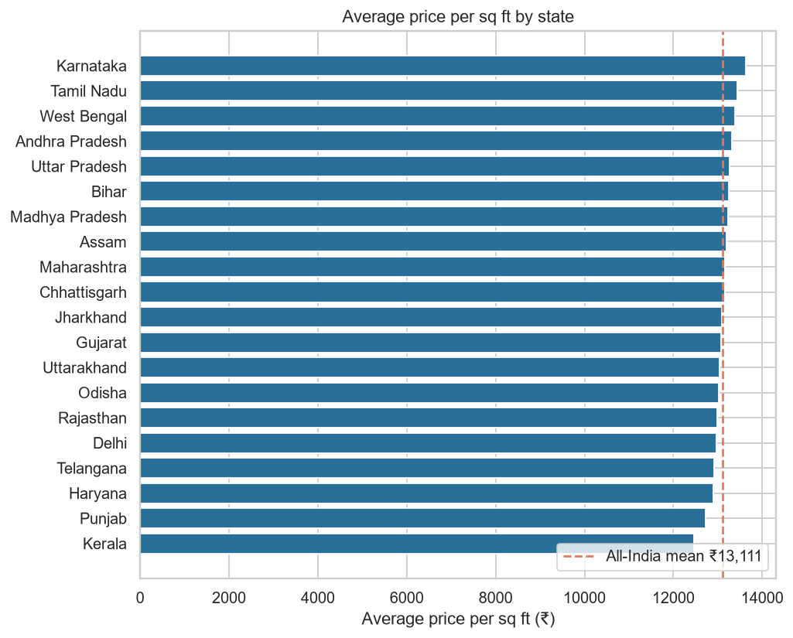

**Finding:** Highest: Karnataka (₹13,633); lowest: Kerala (₹12,463) - a 9.4% spread. ANOVA p=0.844, η²=0.0004 -> no statistically significant difference. State explains 0.04% of the variation in price per sq ft.

| State          |   Avg price/sq ft (₹) |
|:---------------|----------------------:|
| Karnataka      |                 13633 |
| Tamil Nadu     |                 13447 |
| West Bengal    |                 13383 |
| Andhra Pradesh |                 13317 |
| Uttar Pradesh  |                 13266 |
| Bihar          |                 13239 |
| Madhya Pradesh |                 13229 |
| Assam          |                 13188 |
| Maharashtra    |                 13166 |
| Chhattisgarh   |                 13161 |
| Jharkhand      |                 13088 |
| Gujarat        |                 13072 |

### Q7. What is the average property price by city?

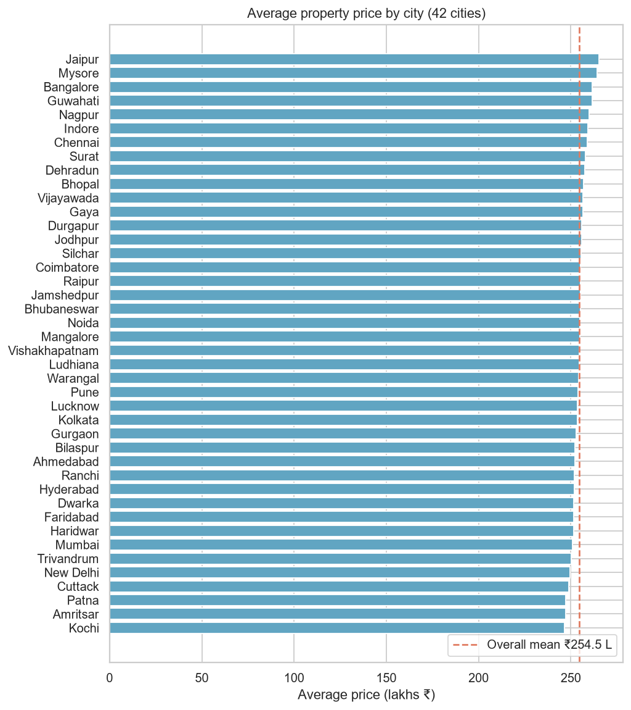

**Finding:** Most expensive city: Jaipur (₹265.1 L); cheapest: Kochi (₹246.5 L) - a 7.5% gap. ANOVA p=0.911, η²=0.0008 -> no statistically significant difference. For reference, Mumbai ranks #36 and Bangalore #3 of 42 - metros are not priced above smaller cities here, unlike the real market.

| City      |   Avg price (lakhs) |
|:----------|--------------------:|
| Jaipur    |               265.1 |
| Mysore    |               264.3 |
| Bangalore |               261.6 |
| Guwahati  |               261.6 |
| Nagpur    |               259.8 |
| Indore    |               259.1 |
| Chennai   |               258.7 |
| Surat     |               257.8 |
| Dehradun  |               257.4 |
| Bhopal    |               257   |

### Q8. What is the median age of properties by locality?

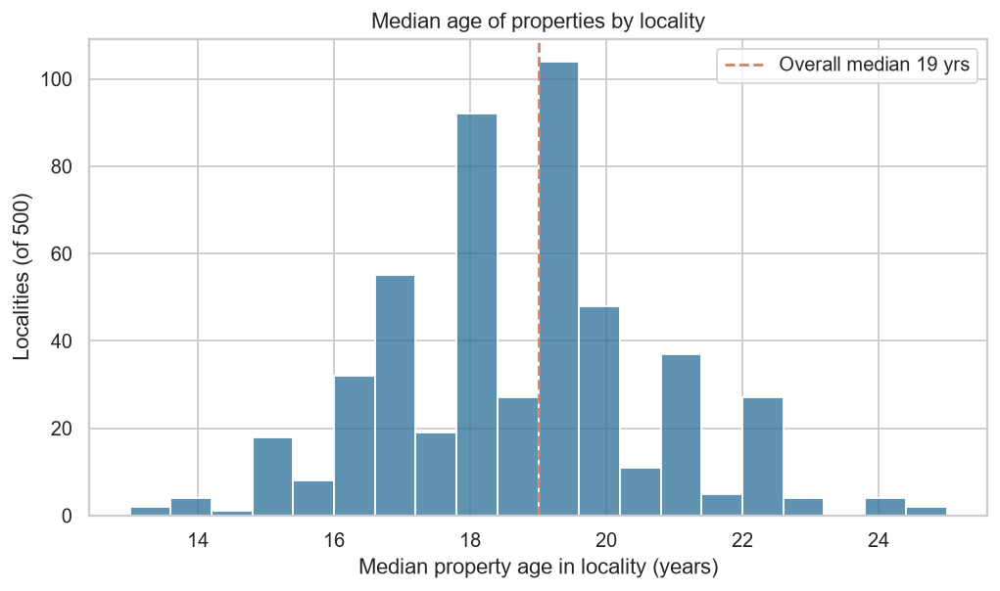

**Finding:** Across 500 localities the median age ranges 13-25 years (middle 50%: 18-20). Oldest: Locality_127 (25 yrs); newest: Locality_19 (13 yrs). Caveat: locality names (Locality_1 ... Locality_500) repeat in every city and hold ~71 listings each, so a 'locality' here is an anonymised label, not one physical neighbourhood.

|    | Group   | Locality     |   Median age (yrs) |   # properties |
|---:|:--------|:-------------|-------------------:|---------------:|
|  0 | Oldest  | Locality_127 |                 25 |             67 |
|  1 | Oldest  | Locality_413 |                 25 |             67 |
|  2 | Oldest  | Locality_366 |                 24 |             68 |
|  3 | Oldest  | Locality_350 |                 24 |             61 |
|  4 | Oldest  | Locality_435 |                 24 |             69 |
|  5 | Newest  | Locality_19  |                 13 |             61 |
|  6 | Newest  | Locality_203 |                 13 |             72 |
|  7 | Newest  | Locality_15  |                 14 |             75 |
|  8 | Newest  | Locality_393 |                 14 |             86 |
|  9 | Newest  | Locality_378 |                 14 |             63 |

### Q9. How is BHK distributed across cities?

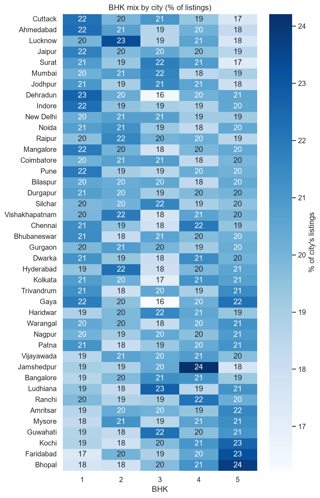

**Finding:** Overall BHK mix: 1 BHK 20.3%, 2 BHK 19.9%, 3 BHK 19.6%, 4 BHK 20.1%, 5 BHK 20.1%. Chi-square test of city vs BHK: p=0.5, Cramér's V=0.034 -> cities have the same BHK mix; any single BHK's share within a city ranges only 16%-24%.

|   BHK |   Share of listings (%) |
|------:|------------------------:|
|     1 |                    20.3 |
|     2 |                    19.9 |
|     3 |                    19.6 |
|     4 |                    20.1 |
|     5 |                    20.1 |

### Q10. What are the price trends for the top 5 most expensive localities?

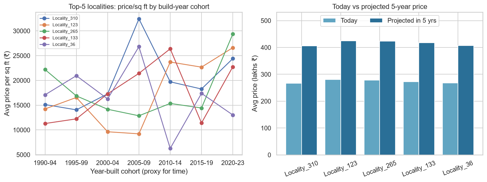

**Finding:** Top-5 localities by average price/sq ft (min 30 listings): Locality_310, Locality_123, Locality_265, Locality_133, Locality_36. The dataset has NO date column, so true price trends over time cannot be measured; the left chart shows price by construction-year cohort (price by vintage, not market movement) and shows no consistent upward or downward pattern. The right chart shows each locality's average price today vs the model's 5-year projection (assumed growth, see config.py).

| Locality     |   Avg price/sq ft (₹) |   # properties |
|:-------------|----------------------:|---------------:|
| Locality_310 |                 18442 |             64 |
| Locality_123 |                 17860 |             63 |
| Locality_265 |                 17738 |             67 |
| Locality_133 |                 17526 |             68 |
| Locality_36  |                 17101 |             71 |

## Relationships

### Q11. How are numeric features correlated with each other?

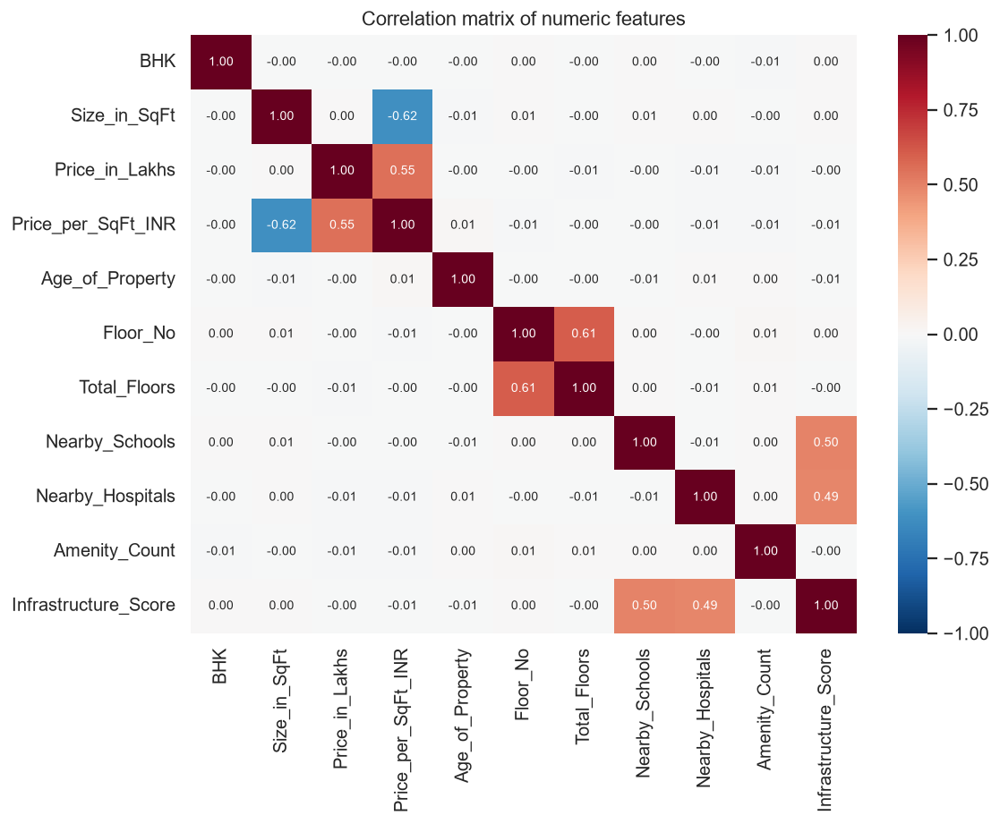

**Finding:** 5 pairs have |r| ≥ 0.3 (Size_in_SqFt vs Price_per_SqFt_INR; Floor_No vs Total_Floors; Price_in_Lakhs vs Price_per_SqFt_INR; Nearby_Schools vs Infrastructure_Score; Nearby_Hospitals vs Infrastructure_Score). Those are built-in: price/sq ft = price ÷ size, Infrastructure_Score is computed from schools/hospitals/transport, and Floor_No vs Total_Floors is lifted by the cleaning step that raised Total_Floors where a flat sat above the stated top floor. No strong relationship is a genuine market signal. Every other pair has |r| ≤ 0.01, i.e. size, floors, amenities and location quality are essentially uncorrelated with price.

|    | Feature A        | Feature B            |      r |
|---:|:-----------------|:---------------------|-------:|
| 14 | Size_in_SqFt     | Price_per_SqFt_INR   | -0.617 |
| 61 | Floor_No         | Total_Floors         |  0.606 |
| 25 | Price_in_Lakhs   | Price_per_SqFt_INR   |  0.553 |
| 87 | Nearby_Schools   | Infrastructure_Score |  0.498 |
| 98 | Nearby_Hospitals | Infrastructure_Score |  0.492 |

### Q12. How do nearby schools relate to price per sq ft?

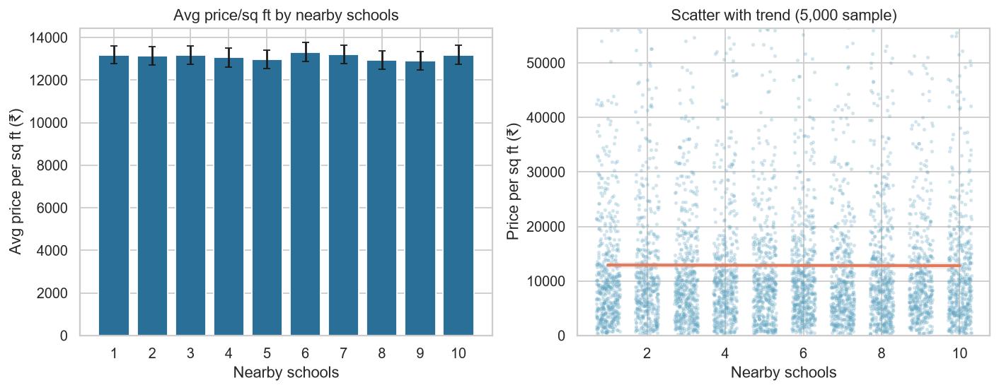

**Finding:** Pearson r between nearby schools and price/sq ft = -0.003 (Spearman -0.006, p=0.62): not statistically significant. Group means vary only 3.1% between the best (6 schools) and worst (9) group; ANOVA p=0.957 -> no statistically significant difference. More schools nearby does not translate into higher price per sq ft here.

|   Nearby_Schools |   count |   mean |
|-----------------:|--------:|-------:|
|                1 |    3592 |  13185 |
|                2 |    3523 |  13144 |
|                3 |    3548 |  13171 |
|                4 |    3443 |  13062 |
|                5 |    3534 |  12984 |
|                6 |    3585 |  13320 |
|                7 |    3451 |  13204 |
|                8 |    3623 |  12940 |
|                9 |    3480 |  12916 |
|               10 |    3580 |  13185 |

### Q13. How do nearby hospitals relate to price per sq ft?

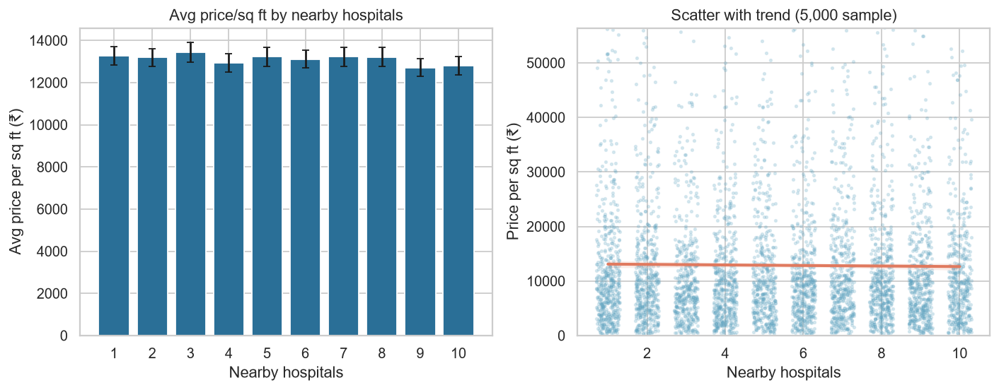

**Finding:** Pearson r between nearby hospitals and price/sq ft = -0.011 (Spearman -0.013, p=0.0443): statistically detectable but negligible. Group means vary only 5.7% between the best (3 hospitals) and worst (9) group; ANOVA p=0.383 -> no statistically significant difference.

|   Nearby_Hospitals |   count |   mean |
|-------------------:|--------:|-------:|
|                  1 |    3635 |  13280 |
|                  2 |    3495 |  13201 |
|                  3 |    3368 |  13440 |
|                  4 |    3661 |  12935 |
|                  5 |    3468 |  13223 |
|                  6 |    3626 |  13110 |
|                  7 |    3486 |  13222 |
|                  8 |    3503 |  13220 |
|                  9 |    3570 |  12710 |
|                 10 |    3547 |  12801 |

### Q14. How does price vary by furnished status?

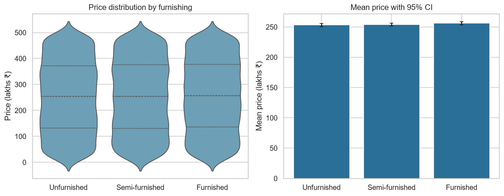

**Finding:** Mean price: highest Furnished (₹256.2 L), lowest Unfurnished (₹253.2 L) - 1.2% difference. ANOVA p=0.238, η²=0.00008 -> no statistically significant difference. Furnishing carries no price premium in this data.

| Furnished_Status   |   count |   mean |   median |
|:-------------------|--------:|-------:|---------:|
| Unfurnished        |   11731 |  253.2 |    253.5 |
| Semi-furnished     |   11811 |  254   |    254.2 |
| Furnished          |   11817 |  256.2 |    256.9 |

### Q15. How does price per sq ft vary by property facing direction?

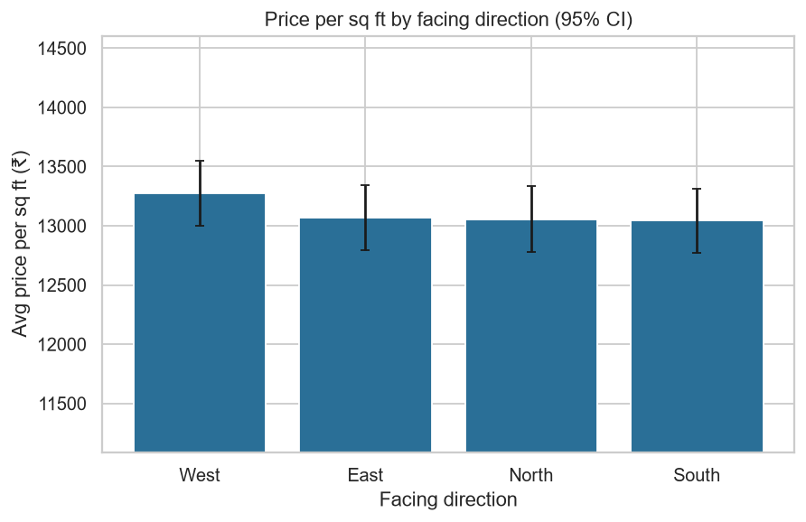

**Finding:** Highest: West (₹13,277); lowest: South (₹13,043) - 1.8% gap. ANOVA p=0.598, η²=0.00005 -> no statistically significant difference. (Y-axis is truncated to make small differences visible - note how small they are.)

| Facing   |   count |   mean |   median |
|:---------|--------:|-------:|---------:|
| West     |    8803 |  13277 |     9428 |
| East     |    8879 |  13069 |     9167 |
| North    |    8802 |  13057 |     9153 |
| South    |    8875 |  13043 |     9254 |

## Investment & Ownership

### Q16. How many properties belong to each owner type?

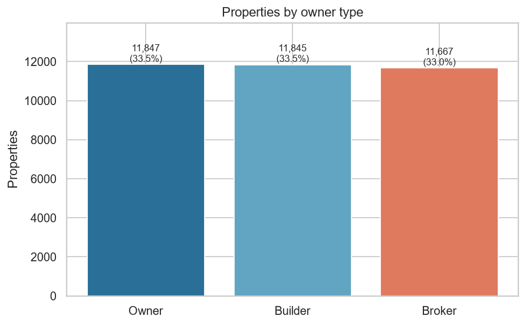

**Finding:** Owner 11,847 | Builder 11,845 | Broker 11,667. Chi-square test against an equal split: p=0.404 -> listings are evenly split across owner types.

| Owner_Type   |   Properties |
|:-------------|-------------:|
| Owner        |        11847 |
| Builder      |        11845 |
| Broker       |        11667 |

### Q17. How many properties are available under each availability status?

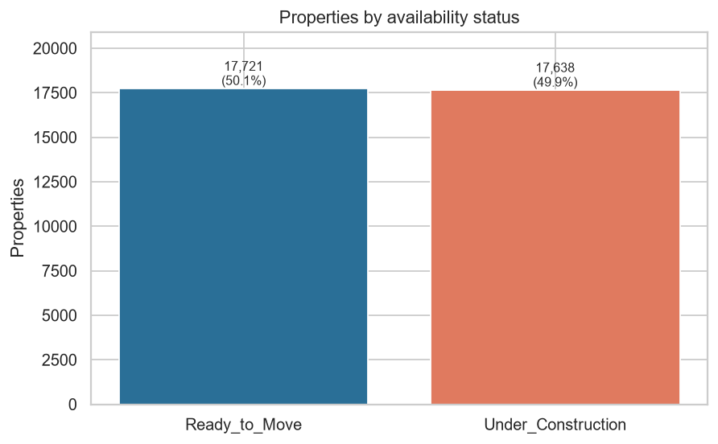

**Finding:** Ready_to_Move: 17,721 (50.1%); Under_Construction: 17,638 (49.9%). Only two statuses exist (the brief also lists 'Sold', which is absent). Chi-square vs equal split p=0.659.

| Availability_Status   |   Properties |
|:----------------------|-------------:|
| Ready_to_Move         |        17721 |
| Under_Construction    |        17638 |

### Q18. Does parking space affect property price?

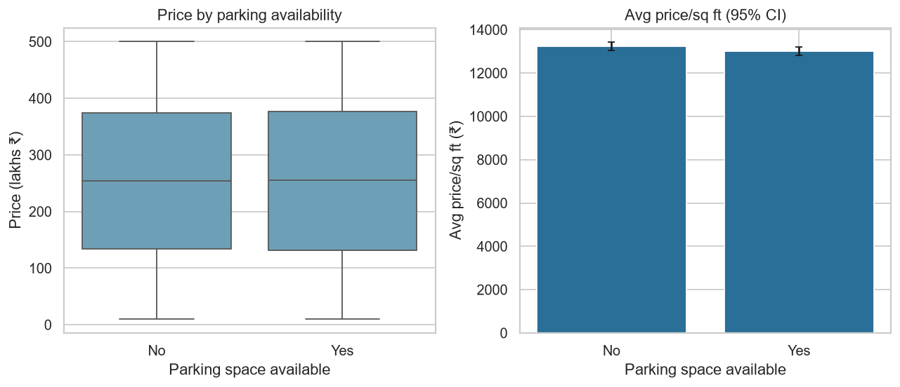

**Finding:** With parking: mean price ₹254.6 L (n=17,691); without: ₹254.3 L (n=17,668) -> +0.1% difference. Welch t-test p=0.831 -> no statistically significant difference: parking does not affect price here.

| Parking_Space   |   count |   mean |   median |
|:----------------|--------:|-------:|---------:|
| No              |   17668 |  254.3 |    254   |
| Yes             |   17691 |  254.6 |    255.7 |

### Q19. How do amenities affect price per sq ft?

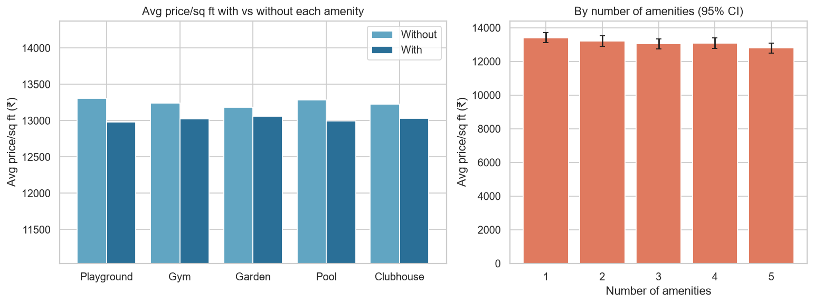

**Finding:** Pearson r between amenity count and price/sq ft = -0.015 (Spearman -0.010, p=0.00539): statistically detectable but negligible. Per-amenity differences range -2.5% to -0.9%; Playground and Pool are statistically significant at p<0.05 (with 5 tests, about 1 false positive is expected by chance); all five point slightly the opposite way to a premium (properties with the amenity are marginally cheaper per sq ft). The gaps are far too small to matter: amenities do not drive price per sq ft in this data.

|    | Amenity    |   Without |   With |   Diff % |     p |
|---:|:-----------|----------:|-------:|---------:|------:|
|  0 | Playground |     13309 |  12980 |    -2.47 | 0.022 |
|  1 | Gym        |     13241 |  13025 |    -1.63 | 0.131 |
|  2 | Garden     |     13186 |  13062 |    -0.94 | 0.388 |
|  3 | Pool       |     13284 |  12996 |    -2.17 | 0.044 |
|  4 | Clubhouse  |     13225 |  13034 |    -1.45 | 0.179 |

### Q20. How does public transport accessibility relate to price per sq ft or investment potential?

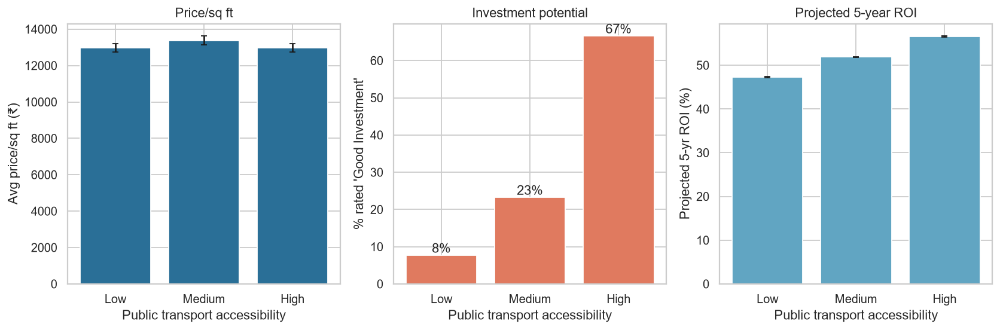

**Finding:** Price/sq ft: ANOVA p=0.0276, η²=0.00020 -> a statistically detectable but practically negligible difference (High ₹12,986 vs Low ₹12,974). Investment potential rises clearly with access: Good-Investment rate 8% (Low) -> 23% (Medium) -> 67% (High), and projected ROI 47.3% -> 56.6%. NOTE: that last link is by design - transport is an input to the growth assumption and the label rule - not an observed market effect.

| Public_Transport_Accessibility   |   Avg price/sq ft |   % Good Investment |   Avg 5y ROI % |
|:---------------------------------|------------------:|--------------------:|---------------:|
| Low                              |             12974 |                 7.7 |          47.28 |
| Medium                           |             13377 |                23.2 |          51.86 |
| High                             |             12986 |                66.6 |          56.57 |

## Step-2 analyses (brief)

### Q21. Price trends by city

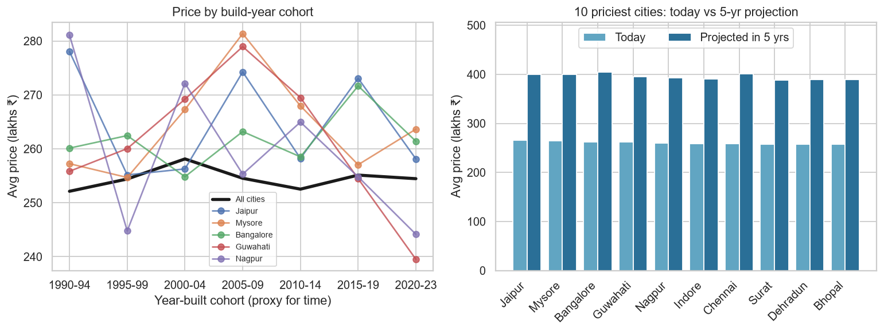

**Finding:** There is no date field, so 'price trend by city' can only be approximated by construction-year cohort. Average price by cohort moves between ₹252.1 L and ₹258.1 L (ANOVA p=0.41, η²=0.00017 -> no statistically significant difference). The right chart shows the model's 5-year projection for the priciest cities.

| City      |   Avg price today (L) |   Avg projected 5y (L) |
|:----------|----------------------:|-----------------------:|
| Jaipur    |                 265.1 |                  400   |
| Mysore    |                 264.3 |                  399.6 |
| Bangalore |                 261.6 |                  404.7 |
| Guwahati  |                 261.6 |                  395.6 |
| Nagpur    |                 259.8 |                  392.3 |
| Indore    |                 259.1 |                  390.5 |
| Chennai   |                 258.7 |                  400.5 |
| Surat     |                 257.8 |                  388.1 |
| Dehradun  |                 257.4 |                  388.9 |
| Bhopal    |                 257   |                  389.1 |

### Q22. Correlation between area and investment return

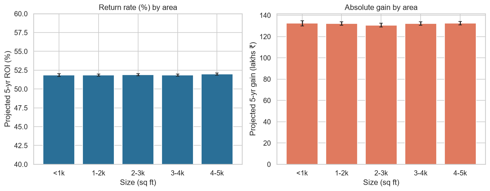

**Finding:** Pearson r between area and projected ROI % = +0.006 (Spearman +0.006, p=0.234): not statistically significant. Pearson r between area and absolute gain = +0.004 (Spearman +0.003, p=0.468): not statistically significant. Return *rate* is unrelated to area (growth does not depend on size in the assumption model, and price is unrelated to size in the data), so larger homes do not yield a better percentage return; absolute gain is simply driven by the price level.

| Size band   |   Expected_ROI_5Y_Pct |   Expected_Gain_Lakhs |
|:------------|----------------------:|----------------------:|
| <1k         |                 51.85 |                132.4  |
| 1-2k        |                 51.84 |                132.34 |
| 2-3k        |                 51.9  |                130.7  |
| 3-4k        |                 51.84 |                132.14 |
| 4-5k        |                 51.98 |                132.62 |

### Q23. Impact of crime rate on Good Investment classification

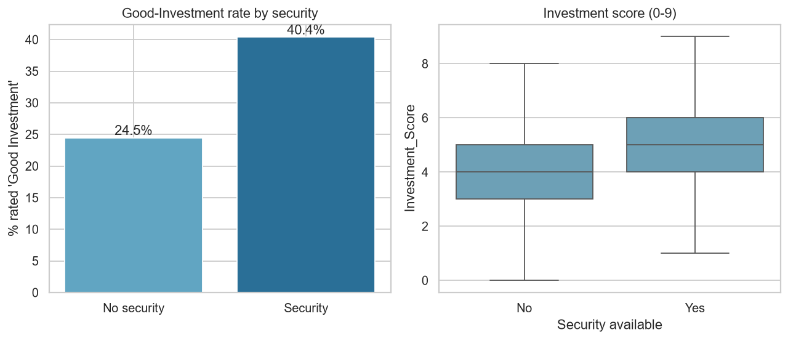

**Finding:** The dataset has NO crime-rate column. Security (gated / CCTV / guard) is the closest safety proxy. Good-Investment rate: 40.4% with security vs 24.5% without (chi-square p=1.7e-223). The gap exists because security is one of the 7 criteria in the label rule (worth 1 of 9 points), so this is a built-in effect, not discovered market behaviour. To test crime impact properly, add a real crime-rate field (e.g., NCRB data by city).

| Security   |   % Good |   Avg score |
|:-----------|---------:|------------:|
| No         |     24.5 |        4.02 |
| Yes        |     40.4 |        5    |

### Q24. Relationship between infrastructure score and resale value

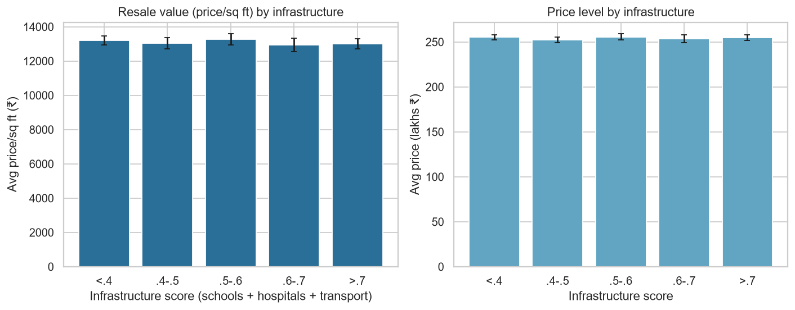

**Finding:** Infrastructure score = mean of school score, hospital score and transport score (0-1). Pearson r between infrastructure score and price/sq ft = -0.006 (Spearman -0.006, p=0.231): not statistically significant. Pearson r between infrastructure score and price = -0.003 (Spearman -0.003, p=0.562): not statistically significant. Better-served properties are not priced higher, so there is no evidence of an infrastructure premium in resale value in this data.

| Infra band   |   Price_per_SqFt_INR |   Price_in_Lakhs |
|:-------------|---------------------:|-----------------:|
| <.4          |              13207.5 |            255.4 |
| .4-.5        |              13039.9 |            252.3 |
| .5-.6        |              13266.9 |            255.6 |
| .6-.7        |              12942.1 |            253.5 |
| >.7          |              13005.3 |            254.6 |
